# Golf course management system

Software for running a public golf course: the starter's tee sheet, check-in and carts, and (coming next) POS, inventory, employee scheduling and accounting. Golfers keep booking with the course's existing provider (for River Bend Golf Club, our first course, that's TeeItUp and GolfNow), and those bookings are pulled into our tee sheet. The v1 spec is in the project's planning doc.

## Layout

| Path | What's in it |
| --- | --- |
| `packages/core` | Pure business logic with no database: tee sheet generation and the rate engine, plus River Bend's rates |
| `apps/api` | Staff REST API (Fastify and PostgreSQL), migrations, seed data |
| `apps/staff` | Staff tee sheet app (Expo / React Native): runs on iPad, phones and the web from one codebase |

## Running locally

Needs Node 22, pnpm 10 and PostgreSQL 16.

```sh
pnpm install
cp .env.example .env        # then: export $(cat .env | xargs)
createdb golf && createdb golf_test
pnpm db:seed                # creates the schema and River Bend, and prints its staff key
pnpm dev:api                # http://localhost:3000
pnpm dev:staff              # staff app in the browser; sign in with the staff key
pnpm test
```

## API

Every `/v1` request needs `Authorization: Bearer <key>` with a staff (`sk_`) key for the course. There is no public booking API: golfers book with the course's own booking provider.

| Method and path | What it does |
| --- | --- |
| `GET /v1/courses/:slug` | Course details and add-ons (carts, rentals) |
| `GET /v1/courses/:slug/tee-sheet?date=YYYY-MM-DD` | Every tee time for the day with its groups and cart numbers |
| `PATCH /v1/courses/:slug/tee-times/:id` | Block or reopen a time, or add a note (for example "Ladies league") |
| `POST /v1/courses/:slug/quotes` | Price a group without booking |
| `POST /v1/courses/:slug/bookings` | Add a walk-in or phone booking |
| `GET /v1/courses/:slug/bookings/:id` | One booking with its price lines |
| `POST /v1/courses/:slug/bookings/:id/payments` | Record a payment: `{ "amountCents": 2900, "method": "cash" }` |
| `POST /v1/courses/:slug/bookings/:id/check-in` | Pro shop check-in. The group must be paid; pass `{ "payment": { "method": "card" } }` to take the balance in the same step |
| `POST /v1/courses/:slug/bookings/:id/tee-off` | Starter check-in at the first tee, optionally with `{ "cartNumbers": ["12"] }`. Only after the pro shop has checked the group in |
| `GET /v1/courses/:slug/waiver` | The cart waiver drivers sign |
| `PUT /v1/courses/:slug/waiver` | Manager only. Reword the waiver: `{ "title": "…", "body": "…" }`. Saves a new version |
| `GET /v1/courses/:slug/me` | Whether this key is a `staff` or `manager` key |
| `PUT /v1/courses/:slug/bookings/:id/carts` | Change cart numbers: `{ "cartNumbers": ["12"], "waivers": [{ "cartNumber": "12", "driverName": "…", "signature": "M10 100 L…" }] }` |
| `POST /v1/courses/:slug/bookings/:id/move` | Move the group to another tee time with room |
| `POST /v1/courses/:slug/bookings/:id/no-show` | Mark a no-show |
| `POST /v1/courses/:slug/bookings/:id/cancel` | Cancel and free the spots |

Example booking:

```json
POST /v1/courses/river-bend/bookings
{
  "teeTimeId": "…",
  "holes": 18,
  "customer": { "name": "Pat Golfer", "email": "pat@example.com" },
  "players": [{ "residency": "resident", "ageGroup": "adult" }, { "ageGroup": "senior" }],
  "addOns": [{ "code": "gas_cart", "quantity": 2 }]
}
```

### How it behaves

- **Tee sheet.** Each course has templates (first and last tee, interval, max players by weekday). A day's tee times are created the first time that day is opened, on the course's local clock, including across daylight saving changes.
- **No double-booking.** A booking locks its tee time row for the transaction, so simultaneous requests for the last spots can't overbook.
- **Rates.** The most specific matching rule wins (residency, age group, time window), and ties go to the lower price. Holidays use weekend rates. 18 holes on a 9-hole course is the 9-hole rate plus the replay rate.

## Tee sheet sync and import

Golfers keep booking on the course's booking provider (TeeItUp or GolfNow). Their bookings come in under **Sync tee sheet** in the app, which managers can open.

**Automatic sync.** A manager connects the provider once. The server then pulls the provider's tee sheet on a schedule (every 5 minutes to 1 hour, 10 by default), and also whenever someone presses **Sync now**. Each pull goes through the same import as an uploaded file, so the rules below apply. The screen shows when the last sync ran and what it changed, or why it failed. A failed or empty pull never changes the tee sheet. There are two ways to connect:
- **Report link.** This is a link to a tee sheet CSV export that the provider publishes or schedules. The link must be https. The server refuses links to private network addresses and redirects, gives up after 20 seconds, and caps the file at 6 MB.
- **Provider API.** This needs partner API access that the provider grants to the course. The course or facility ID and API key are stored encrypted (AES-256-GCM, using `SYNC_SECRET`) and are never sent back to the app. Until the provider grants access, a sync shows "waiting for provider access" and doesn't pretend to have synced.

Set `SYNC_SECRET` on the server to a long random string before saving provider API details. The sync loop starts with the API server (`src/server.ts`), and running more than one server is safe because each course's sync is claimed before it runs.


**File import.** A manager can also export the tee sheet as a CSV file and upload it on the same screen. The app first shows what would change, and then applies it.

- **Columns:** headers are matched loosely ("Tee Time", "Time", "Start Time" all work). The file needs a date, a tee time and a golfer name. It also uses players, holes, price, amount paid online, status and confirmation number when they're there.
- **Re-importing** matches bookings on the provider's confirmation number, so nothing is duplicated:
  - New bookings are added.
  - Changed ones are updated (a moved time, more players, a new price).
  - Bookings cancelled on the provider, or missing from a day the file covers, are cancelled here.
  - Groups already checked in or on the course are never touched.
- **Money paid online** is recorded as a prepaid payment, so the pro shop sees "Paid".
- **Pricing:** with no price in the file, our own rates price the booking.
- **Times we don't have:** a tee time the provider has and our sheet doesn't (a shotgun start) is added. Overbooked times are flagged.
- **API:** `POST /v1/courses/:slug/imports` with `{ "source": "teeitup" | "golfnow" | "import", "csv": "…", "dryRun": true }`. Manager keys only. `GET …/imports` lists recent runs.

Live sync: TeeItUp's API is only open to approved partners. Once River Bend (or we) get access, a sync job will feed the same import every few minutes, and the file import stays as a backup.

## Card payments

Cards work with whatever setup a course already has. A manager picks one under **Settings → Card payments**:

- **Standalone terminal (record only).** This is where every course starts. Staff run the card on the course's own terminal, and the register records that it was paid by card.
- **Stripe Terminal.** Stripe readers (WisePOS E, S700, and similar) are driven from the server. Enter the secret key, and optionally a terminal location id and a webhook signing secret.
- **Square Terminal.** Square Terminal devices paired to the location are used through the Terminal API. Enter the access token and the location id, and choose sandbox or production.
- **Simulator.** For training and demos. It approves the card about 2½ seconds after the amount is sent, and declines amounts ending in 13 cents so staff can practise both outcomes.

Once a processor is connected, the manager presses **Find readers** and adds each reader with a name staff will recognise ("Pro shop counter", "Bar", "Halfway house"). Each iPad or computer then picks the reader next to it in Settings; if the course has only one reader, it's picked automatically.

When staff take a card payment at check-in or at the register, the amount goes to the reader and a **Waiting for the card…** window stays open until the golfer taps, inserts or swipes. If the card is declined, staff can try again or switch to another method. One tap covers everything paid by card, the round and any items together. The server finishes the check-in or sale only if the processor says the card went through for exactly that amount, and each card payment can pay for only one thing. Refunding a register sale puts the money back on the card it came from.

The server learns that a card went through in one of two ways. The app checks every 1.5 seconds. A processor can also call `POST /v1/webhooks/payments/<course>/<stripe|square>`; the webhook's signature is checked, and then the payment is looked up fresh from the processor. Set `PUBLIC_URL` to the server's public address so Square's signature, which covers the URL, matches. Processor keys are encrypted with the same `SYNC_SECRET` as the tee sheet sync keys and are never sent back to the app.

**Adding another processor** (Clover, Adyen, Global Payments, Moneris, and so on) means writing one adapter in `apps/api/src/terminals.ts` with the same six calls: list readers, start a payment, get its status, cancel, refund, and read a webhook. Nothing else in the app changes.

API: `GET/PUT /settings/payments`, `GET /settings/payments/readers`, `GET/POST /terminals`, `PATCH /terminals/:id`, `POST /card-payments`, `GET /card-payments/:id`, `POST /card-payments/:id/cancel`, `POST /card-payments/:id/refund` (managers), and `GET /card-payments?date=` (managers, for matching against the processor's payout). Check-in and `POST /sales` take a `cardPaymentId`.

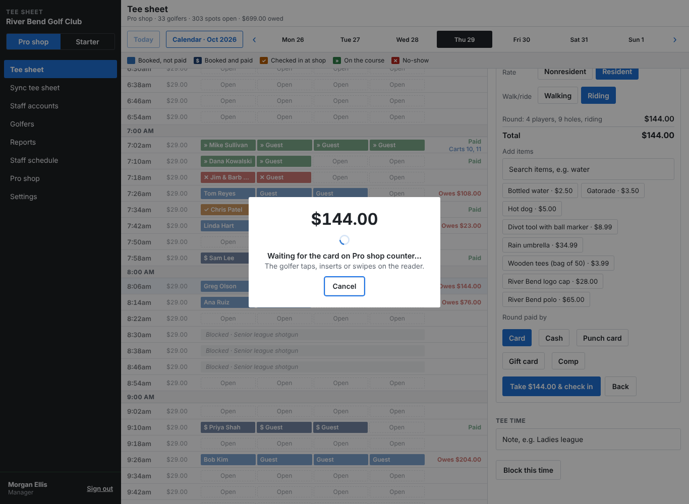

## Punch cards, passes and loyalty points

Managers set up what the course sells under **Pro shop › Passes & points**: punch cards (a number of rounds) and season passes (unlimited rounds for the holder), each with a price, how many days it's good for and whether it includes a cart. The same tab turns loyalty points on and sets the rates: points per dollar, and how many points take how much off a round. Setting points per dollar to 0 turns them off.

- **Selling.** On a golfer's account, **Sell a pass** rings it up as a pro shop sale (category "Passes", untaxed) and adds it to the account. Card sales go through the card reader.
- **Using.** At check-in, a linked golfer's usable passes and points appear in the checkout. Each round on a punch card covers one player's green fee, plus their cart if the card includes one. A season pass covers the holder only. Points come off in whole rewards. The total updates as these are picked, and whatever's left is paid the usual way. On the API, check-in takes `pass: { golferPassId, rounds }` and `points`.
- **Earning.** Golfers earn points on money they spend on rounds (card, cash or gift card) and in the pro shop. Rounds paid with a pass, points or a comp don't earn. A refunded sale takes its points back.
- **Fixing.** Managers can cancel a pass sold by mistake (refund the sale separately) and add or take away points with a reason. Every change to points is kept in a ledger shown on the account.

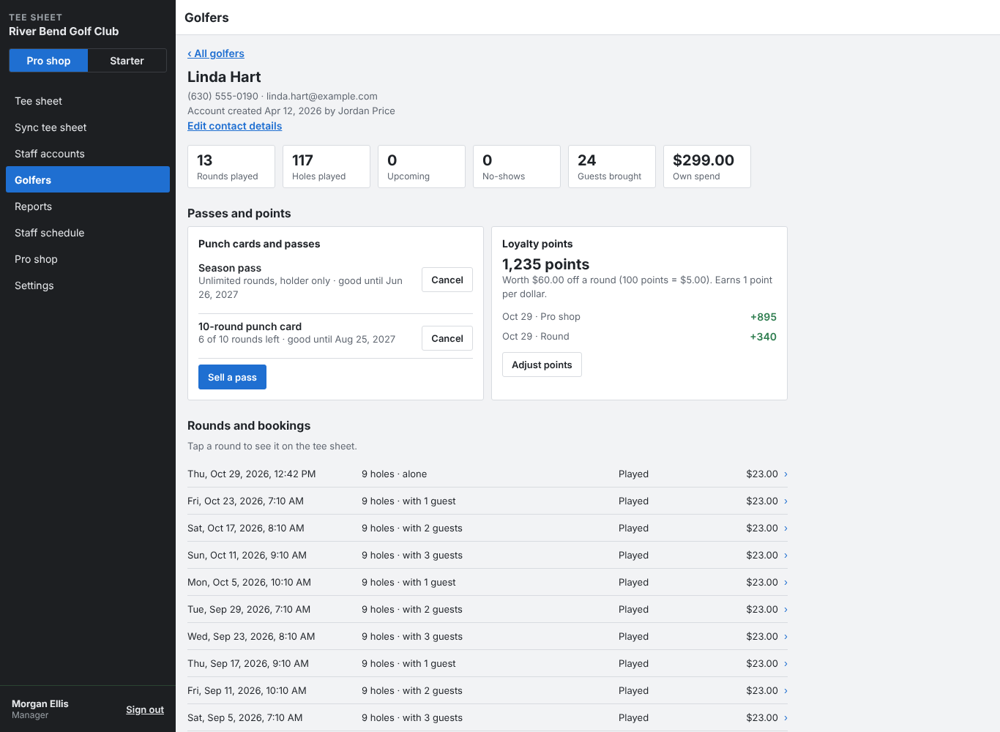

## Rain checks and refunds

When weather cuts a round short, the pro shop opens the group's tee time and presses **Rain check** (for groups that have checked in). They pick how many players and how many holes were played. The credit is worked out from what the group paid for the holes they didn't play, with or without carts, and managers can set a different amount. The golfer gets a code like `RC-7K2M9Q`, good for 365 days by default (set under **Pro shop › Passes & points**). It's also listed on their golfer account if the round was linked to one. At a later check-in, staff pick the rain check from the account or type the code. It pays toward the round, and anything left stays on the code. Managers can void a rain check that hasn't been used.

Managers can also **Refund** a round, by cash or back to the card. Card refunds go through the reader's processor when the round was paid on one. Either way, the amount comes off the round as its own line ("Rain check RC-…" or "Refund: reason"), so revenue counts the round at what it ended up costing. A refund is recorded as a negative payment on the day it's given, so money taken and the cash drawer net it out.

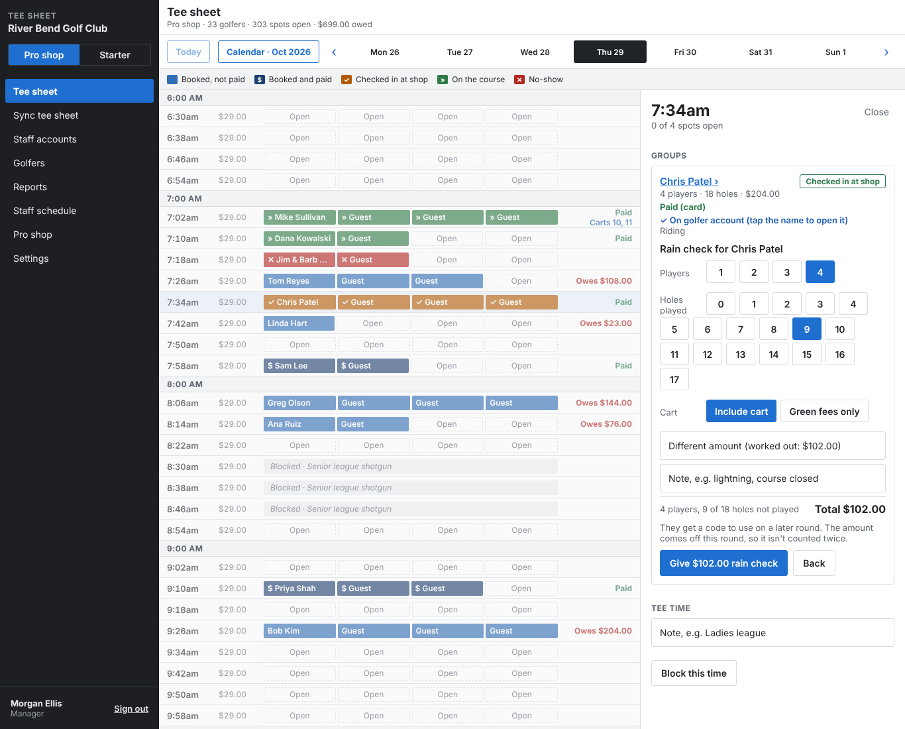

## Leagues, outings and standing tee times

**Leagues & events** holds a course's weekly leagues and one-day outings. A manager sets one up with a price per player, holes, whether carts are included, and who the bill goes to, then picks the first (and for a league, last) date, the first tee time and how many tee times to hold. The app blocks those tee times on the tee sheet for every date. Any time that already has golfers on it is left alone and listed, so staff can move the golfers or play around them. Events run as one group per tee time or as a shotgun start, where groups are given starting holes (1A, 2A … then 1B for a second group on a hole).

On the day, the pro shop opens the date, pairs everyone into groups (by handicap so groups are even, by random draw, or by name), moves players between groups by tapping them, and checks groups in. The event is billed as one account: each date charges the players who checked in (or who are in a group, before check-in starts) at the event's price, and payments by card, cash, check, gift card or comp are taken against the balance, for the whole season or a single date. Event payments show in reports as "Leagues and outings" and count in the cash drawer. Managers can cancel a rained-out date, which frees its tee times and drops its charge.

**Standing tee times** are a golfer's permanent weekly time, such as Saturdays at 7:02 for a foursome. The golfer is booked 8 weeks ahead, and again whenever a later day is opened on the tee sheet. If a week can't be booked (the time is blocked or full), it's listed on the standing time so staff can sort it out. Stopping a standing time cancels its future bookings that haven't checked in.

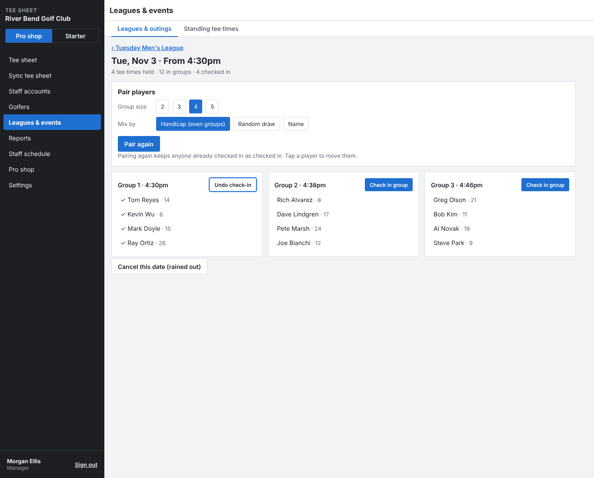

## Food and bar

**Food & bar** runs the grill, the bar, the turn stand and the beverage cart on open tabs. Staff open a tab for a table or a name, a golfer account (so it earns loyalty points), or a group on the course today, so food ordered at the turn goes on that golfer's tab. Tapping menu items builds the order, with a note for the kitchen ("no onions"), and **Send order** puts anything made in the kitchen or at the bar straight onto that screen. Prices are locked in when the order is placed.

The **Kitchen screen** and **Bar screen** show one ticket per order, oldest first, with how long it's been waiting (amber after 8 minutes, red after 15). The cook taps each item as it's made and presses **Served** to clear the ticket. The screens refresh on their own, so they can stay up on a tablet in the kitchen.

At the end, the tab is paid by card (on the reader), cash, gift card or comp. It becomes a normal register sale, so sales tax, stock counts, loyalty points and the cash drawer all work as they do at the pro shop. Anyone can take off an item the kitchen hasn't started. Once it's made, or to void a tab with items on it, a manager has to do it.

Menu items are products with **Food or drink** turned on, and optionally **Made in the kitchen** or **Made at the bar** (set under **Pro shop**). Reports show food and drink as their own revenue line and category breakdown, apart from the pro shop.

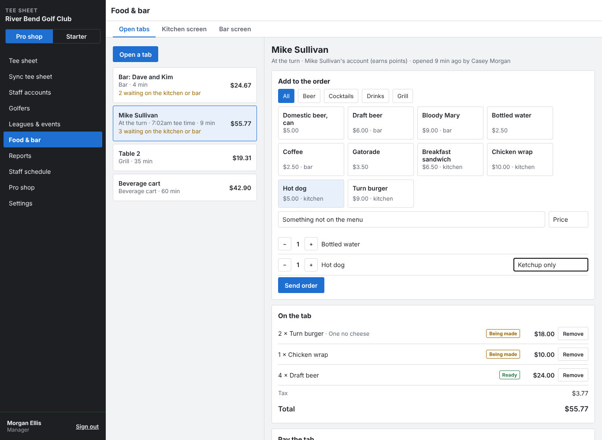

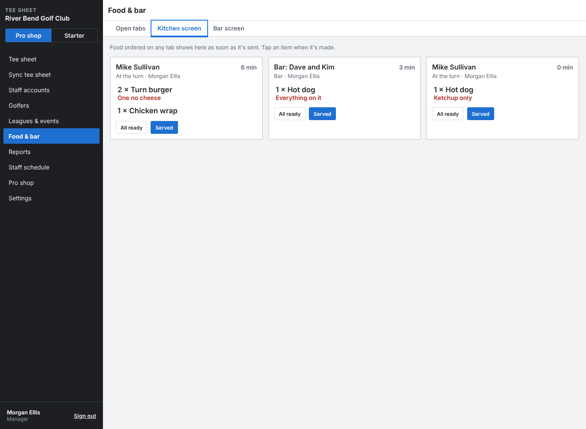

## Gift cards and house accounts

**Gift cards & accounts › Gift cards** sells a card for any amount, by card, cash or check (managers can also give one away). The golfer gets a code like `GC-7K2M-9QXA`, and the card can go on their golfer account so it shows up at check-in. More can be added to an existing card. A gift card pays for a round (anything it doesn't cover is paid the usual way), a register sale, or a food and bar tab, by picking it from the golfer's account or typing the code. Leaving the code blank records a paper certificate the shop doesn't track. Selling a card is money taken but not revenue. The revenue counts when the card is spent, and reports say how much of the day's money was gift cards sold. Managers can fix a balance or void a lost card, and every change is in the card's history.

**Gift cards & accounts › House accounts** is for members who charge to an account and are billed monthly. A manager opens an account for a golfer, with an optional limit. Rounds at check-in, register sales and food and bar tabs can then be charged with **House account**, and each charge lists what was bought. A charge over the limit, or on an account that's on hold, is refused. Charges count as revenue on the day they're made. Payments on the account (check, cash or card) count as money taken that day and go in the cash drawer count, without counting the revenue twice. Once a month is over, a manager presses **Make … statements**: each account gets a statement with the opening balance, every charge and payment, and the amount due (15 days later). Running it again for the same month does nothing new. Statements open as a printable page. Emailing them waits on golfer messaging (item 9).

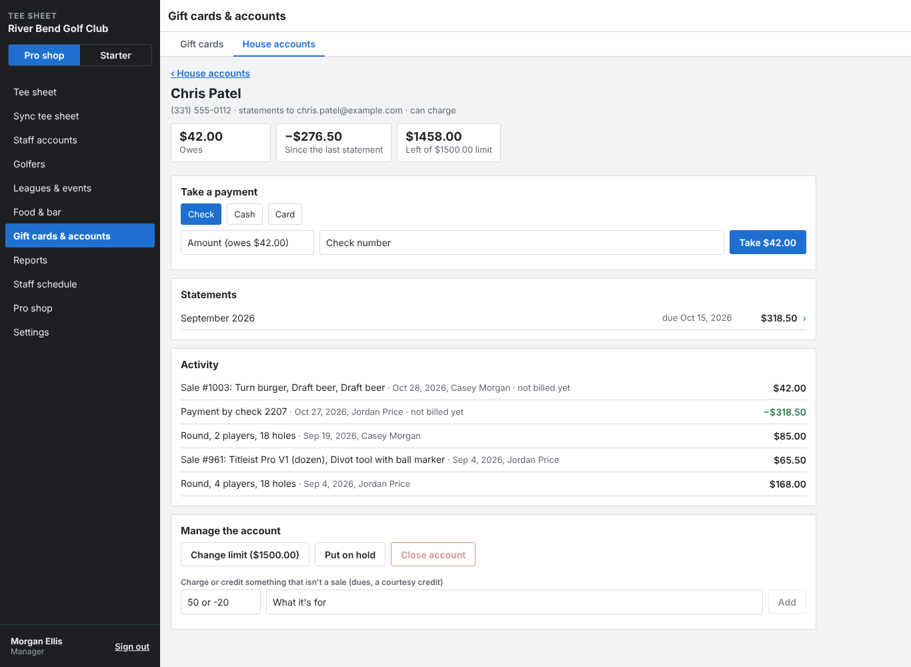

## Accounting export

**Reports › Send to accounting** (managers) turns the report's dates into one balanced journal entry per day that QuickBooks Online or Xero imports, so the bookkeeper doesn't retype the day's totals. Money taken is debited to where it went (cash and checks to Undeposited Funds, cards to Card Clearing, gift cards and rain checks spent against what's held for golfers, charges to house accounts receivable). Revenue (green fees, carts and extras, pro shop, food and drink, leagues and outings), sales tax, gift cards sold and payments on house accounts are credited. A round paid on a different day than it's played lands in a clearing account, which evens out across days. **Show the entries** previews each day; **Download import file** saves the CSV (`Journal No, Journal Date, Account, Debits, Credits, Description` for QuickBooks, the manual journal layout for Xero) and records who exported which dates. **Account names** sets the course's own names (QuickBooks) or codes (Xero) for each line.

API: `GET/PUT /settings/accounting`, `GET /accounting/journal?from&to` (up to two months), `POST /accounting/export`.

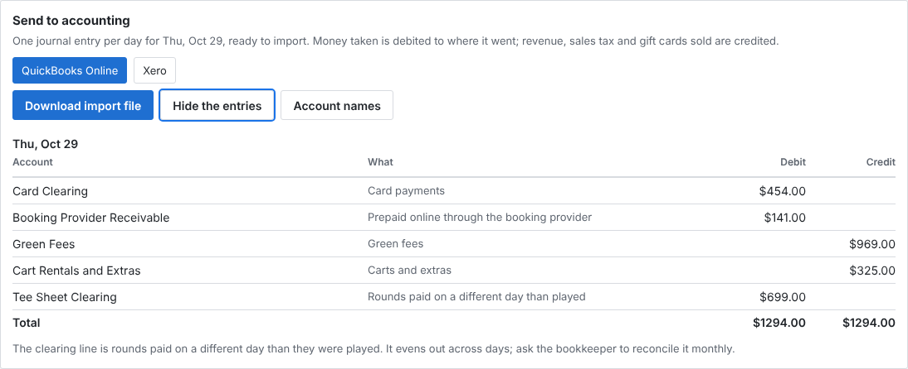

## Carts and maintenance

**Carts & maintenance › Carts** is the cart board: every cart with whether it's free, out on the course (and with which group), or out of service and why. A manager adds the fleet once (**Add carts**, numbers 1 to 60 in one go, with how many rounds between services). From then on the starter can only hand out carts that are in the fleet and in service, picks free carts by tapping their numbers, and marks a group's carts back in when they return (a cart counts as back six hours after tee off anyway). Rounds are counted on each cart from the cart numbers given at the tee, so **Service due** shows up on its own; logging a service restarts the count. Until any carts are added, any cart number is accepted, as before.

**Equipment** lists mowers, utility vehicles and other machines with their hour meter and service interval in hours. **Work orders** is for anything that needs fixing, on a cart, a machine, the course or the clubhouse: anyone on staff can report a problem (optionally taking the cart out of service until it's fixed), assign it, set how urgent it is and when it's due, add notes and move it along. Finishing one on a cart or machine records the repair and cost in its service history and can put it back in service. Only managers cancel a work order.

API: `GET/POST /fleet`, `POST /fleet/carts`, `GET/PATCH /fleet/:id`, `POST /fleet/:id/status`, `POST /fleet/:id/service`, `PUT /fleet/:id/hours`, `POST /bookings/:id/carts-in`, `GET/POST /work-orders`, `GET/PATCH /work-orders/:id`, `POST /work-orders/:id/status`, `POST /work-orders/:id/notes`.

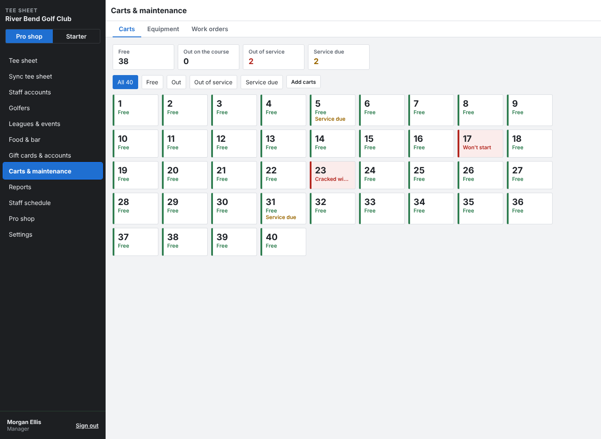

## Golfer messages

**Messages** sends an email, a text, or both to a group of golfers: everyone booked on a day (optionally between two times), the players in a league or outing, or one golfer. Managers can also message all golfers or all house account holders. `{first_name}`, `{tee_time}`, `{date}` and `{course}` are filled in for each golfer, and emails end with the course signature (**Messages › Settings**, which also sets the from name and reply-to address). Before sending, the screen says how many golfers it reaches by email and by text and how many can't be reached. After sending, **Sent** shows every golfer, the address used, and why anyone was skipped (no email, no mobile number, opted out).

Messages to all golfers or all house account holders count as marketing and leave off golfers who opted out; the switches are on each golfer's page, along with the messages they've been sent. Messages about a golfer's own tee time, and statements, go either way. Managers can email a house account statement from the statement page.

No email or text provider is connected yet, so the app runs in practice mode: every message is recorded exactly as the golfer would get it, but nothing is delivered. Connecting a provider (for example SendGrid or Postmark for email and Twilio for texts) means adding a `MessageSender` in `apps/api/src/messages.ts`.

API: `POST /messages/preview`, `POST /messages`, `GET /messages`, `GET /messages/:id`, `GET /golfers/:id/messages`, `POST /statements/:id/email`, `GET/PUT /settings/messaging`, plus `emailOptOut` and `smsOptOut` on `PATCH /golfers/:id`.

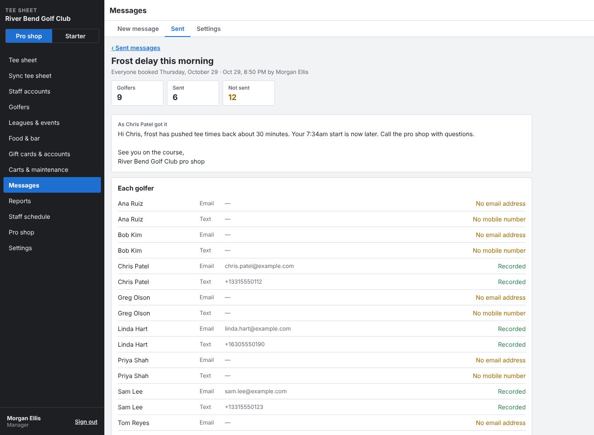

## Weather and frost delays

**Weather delay…** on the tee sheet (today or a day ahead) is for frost, fog, lightning and other holds. Pick why, the first tee time to push back, and by how long. Every tee time from then on moves later by that much, groups and all, so the gaps between groups stay the same; the form says how many tee times and groups move and what the last tee time becomes. By default the golfers whose times moved get a text and an email with their own new tee time (the wording can be changed before sending, and **Messages › Sent** shows who couldn't be reached). The tee sheet shows a banner for the delay, and the latest delay on a day can be taken back.

The booking system keeps its original times. Template tee times made for a delayed day, and bookings synced from TeeItUp or GolfNow, are moved through the day's delays so they land on the delayed sheet; so push the delay back here, not in the booking system as well.

API: `GET /tee-sheet/delays?date`, `POST /tee-sheet/delays`, `POST /tee-sheet/delays/:id/undo`.

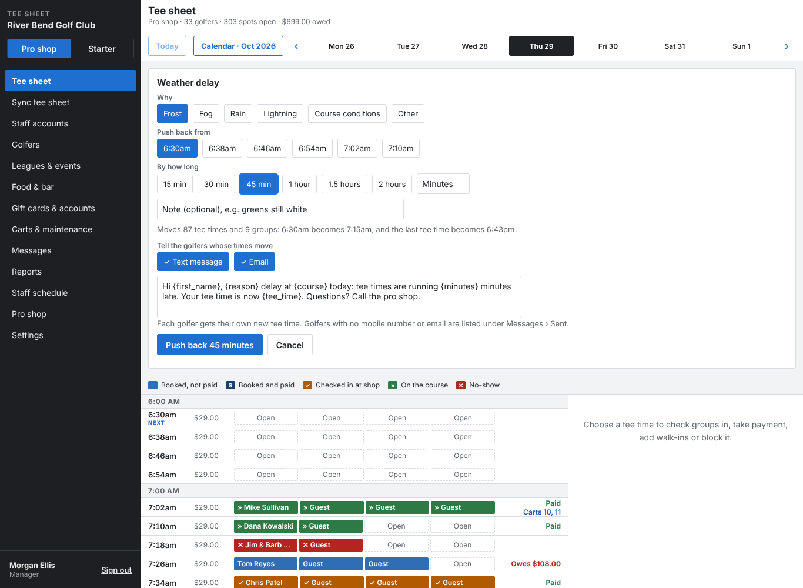

## AI assistant

Managers can ask Claude, ChatGPT or another MCP client about the course: "how many rounds today?", "who still owes?", "is Mike Sullivan booked this week?", "what did we take last week?". Add a custom connector with the address `https://<your server>/v1/courses/<course>/mcp` and the manager key as a Bearer token.

| Tool | Answers |
| --- | --- |
| `day_summary` | Groups, players, checked in, on course, no-shows, open spots, occupancy, money booked, collected and owed, carts out |
| `list_groups` | The day's groups in tee time order, filtered to unpaid, not checked in, checked in, on course or no-shows |
| `find_golfer` | A golfer's bookings 30 days either side of today |
| `revenue` | Green fees, add-ons and payments by method per day, up to 92 days |

Every tool only reads. Changes still go through the staff app.

## Staff app


The app has a menu on the left (Tee sheet, Golfers, Reports, Staff schedule, Pro shop, Settings). On phones and iPads held upright, the menu folds behind a ☰ button. The tee sheet has one slot per player. Each group is colored by where it is (booked, paid, checked in at the shop, on the course, no-show), and a color key sits above the grid. Each row also shows the time's standard price and what the group owes, with hour dividers and a week strip to move between days.

Accessibility: every row and button has a spoken label for screen readers (for example "7:26am: Tom Reyes, 3 players, booked, not paid, owes $108.00; 1 open"). Keyboard focus is visible. Group colors have at least 4.5:1 contrast with their text, and each state also has its own mark (✓ ⛳ ✕ $), so color is never the only cue. Confirmations happen on the page instead of in pop-up dialogs.

Each device is set to **Pro shop** or **Starter** (switchable in the top bar). Check-in has two steps: the pro shop takes payment and checks the group in, then the starter checks them in at the tee box and assigns carts. The starter can't send off a group the pro shop hasn't checked in.

Each row shows the time, filled spots, the groups (✓ checked in at the shop, ⛳ on the course, ✕ no-show), cart numbers, and whether the time is paid or what's owed. Tapping a time opens a panel to take payment and check in, send a group off with carts, mark no-shows, move a group to another time, cancel, add a walk-in, or block the time with a note. On an iPad in landscape or a desktop the panel sits beside the sheet; on a phone it slides up. The sheet refreshes every 5 seconds, so changes from the pro shop show up on the starter's iPad.

**Cart waivers.** When carts are assigned, the app pops up the course's cart waiver for each cart's driver in turn: they read it, enter their name, tick that they agree, and sign with a finger. A cart can't be assigned until its driver has signed (the API enforces this too, on every route that sets carts). Each signature is stored with the driver's name, the cart, the exact waiver version and the time. The seeded River Bend waiver is sample text: the course must supply its own reviewed wording.

**Staff sign-in.** Each employee and manager signs in with their own email and password. `pnpm db:seed` creates a first manager account (manager@riverbend.example) and prints its one-time password. Managers add everyone else under **Staff accounts**, where they can also make someone a manager, reset a forgotten password and turn off the account of someone who leaves (that signs them out everywhere). Every change on the tee sheet is logged with who made it, shown under **Recent activity**. After 5 wrong passwords an email is locked for 15 minutes. Sessions last 14 days from last use, so a busy iPad stays signed in. A shared device key (sk_) still works for a kiosk nobody signs in to.

**Employee types.** Each person has an employee type, which is the job they do: Pro Shop, Ranger/Starter, Cart Attendant, Bartender, Food & Beverage or Grounds Crew to start with. Managers pick it when adding someone and can change it later. Managers can also add their own types (such as Golf Instructor), rename them or remove them. A removed type stays on the people who have it until they're changed. The type is separate from access: staff or manager access decides what someone may change.


**Golfer accounts.** The first time a golfer is checked in, the pro shop creates their account with their own phone and email (each can only belong to one golfer). After that, **Check in** asks which golfer it is and staff find them by name, phone or email, so every round lands on the same account. If the golfer booked online before with the same email, that record becomes the account and the earlier bookings count too. **Golfers** in the menu shows each account's rounds played, holes, upcoming bookings, no-shows, payments and full history. A golfer who won't give details can still be checked in without an account. On the tee sheet, tapping a linked golfer's name opens their account. On an account, tapping a round opens the tee sheet at that day with the tee time selected.


**Staff schedule.** Everyone sees the week's shifts, one row per person, with open shifts nobody has yet at the bottom. Managers add, change and remove shifts (each can have a job and a note), and **Copy last week** fills a new week from the one before, skipping anything that would clash. A person can't be given two shifts that overlap. Anyone signed in with their own account can **clock in and out**; the punch is tied to the shift they're working. Managers see **Timesheets**: scheduled hours against worked hours for each person, with every punch. The API can already correct a punch (marked as edited); the screen for it is still to come.

**Shift swaps.** Tap one of your upcoming shifts to ask a coworker to take it, or to trade it for one of theirs. The coworker accepts or declines. A manager then approves or turns it down, and only then does the schedule change. **Manager must approve swaps** is on by default; a manager can turn it off on the Shift swaps tab, and then the swap happens as soon as the coworker accepts. Changing a shift by hand cancels any swap still open on it.


**Guests.** To add guests to a golfer's group, slide the golfer's name to the right across the open spots on the tee sheet: each spot it covers becomes a guest (shown as "+ Guest" while dragging). Letting go opens the tee time with the guests ready to confirm, where staff choose walking or riding (and, at the pro shop, the rate) before adding them. **Add guests** in the tee time panel does the same without dragging. Guests are priced like walk-ins and added to the group's bill, so they count toward the course's revenue. On the golfer's account they're listed (how many guests each round, and guests brought in total) but their fees aren't counted as the golfer's own spending: **Own spend** is the golfer's share of each group's payments, split evenly across the players.

**Moving a group.** Drag a golfer's name up or down the tee sheet to move their whole group to another time. The time under the name is outlined: blue with "Move here" when the group fits, red with "No room" when it doesn't (or it's blocked). Letting go moves them (nothing else opens), and a bar at the top says where they went with an **Undo** button. Holding the name near the top or bottom of the list scrolls it, so earlier or later times can be reached. On iPads and phones, a finger on a name drags it; scroll the sheet by the times or open spots. Groups that are booked or checked in can be moved; ones already on the course can't. **Move** in the tee time panel does the same by picking a time.

**Removing golfers.** Tap a time and press **Remove** on the group. Pick **Whole group** to cancel the booking and open its spots, or pick how many players aren't coming (2 of a foursome, say) to keep the rest booked. Taking players off drops the bill by their green fees, replay fees and carts, guests first. Groups that haven't checked in can be removed, including no-shows. A group that has already paid more than its new total is refused, since that would need a refund.

If a group marked as a no-show turns up late, **Undo no-show** puts them back to booked so they can check in as usual. It's refused if their spots were given to someone else in the meantime; move them to another time instead.

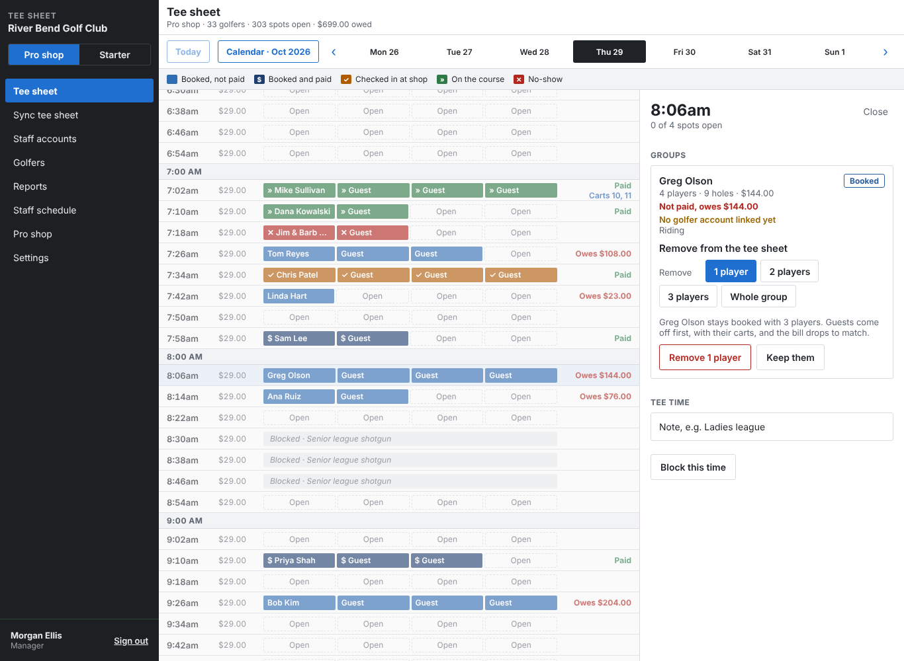

**Check in.** Tapping a golfer's name opens their tee time with their group outlined and a large **Check in** button showing what's due. At the pro shop it takes payment (and any items) and checks them in. Until a group has paid anything, the checkout also has **Rate** (nonresident/resident) and **Walk/ride** choices for the whole group: changing them re-prices the round, and the **Take $X & check in** amount updates with them and with each item added. On the starter screen, groups the pro shop has checked in get **Check in at the tee**, which asks for cart numbers and waivers and sends them off.

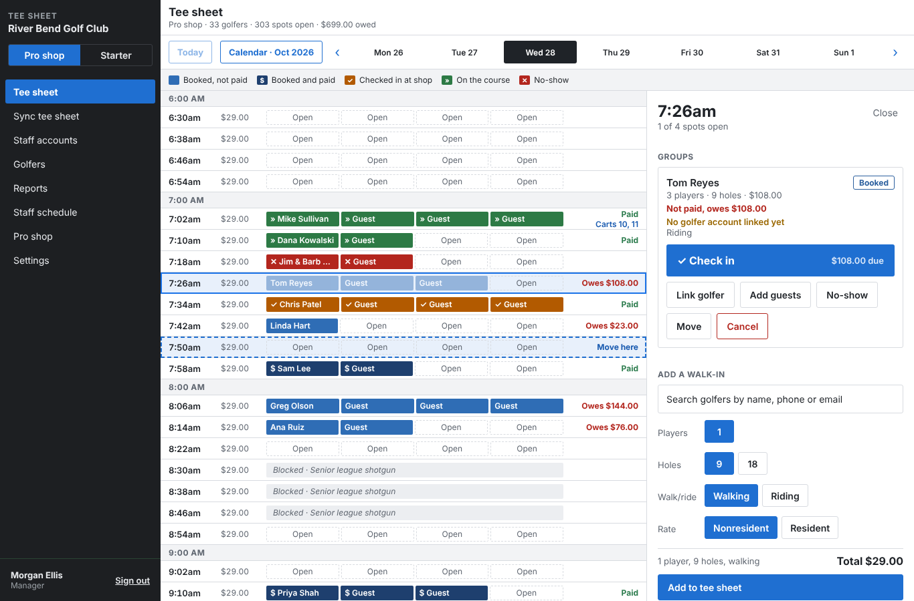

**Walking or riding.** Walk-ins and guests are booked as walking or riding (riding adds a gas cart per player), and each group in the panel shows which.

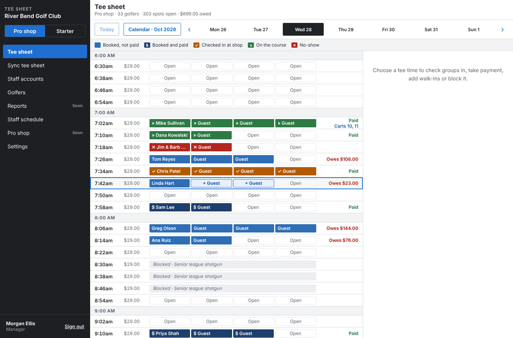

**Pro shop.** The **Register** tab rings up sales: tap products (filter by category, or search by name or scanned SKU), change quantities, add a one-off item that isn't in the list, and optionally attach the sale to a golfer account. Tax is added on taxable items at the course's rate (a manager sets it; comps aren't taxed), then staff pick card, cash, gift card or comp and charge. Each sale gets a receipt number. **Inventory** lists products with stock on hand, reorder levels and a low-stock flag (the tab shows how many are low), plus the value of stock at cost. Anyone can record a delivery received; managers add products, remove them, and change the price or the number in stock in the same edit form (or count the shelf, or adjust with a reason). After that, every sale takes stock down automatically and a refund puts it back. Every stock change is kept in the product's history with who made it. **Today's sales** shows the day's sales with totals before tax, tax, and breakdowns by payment and category; managers can refund a sale, which puts stocked items back. Card payments are recorded, not processed: the card reader is still separate.

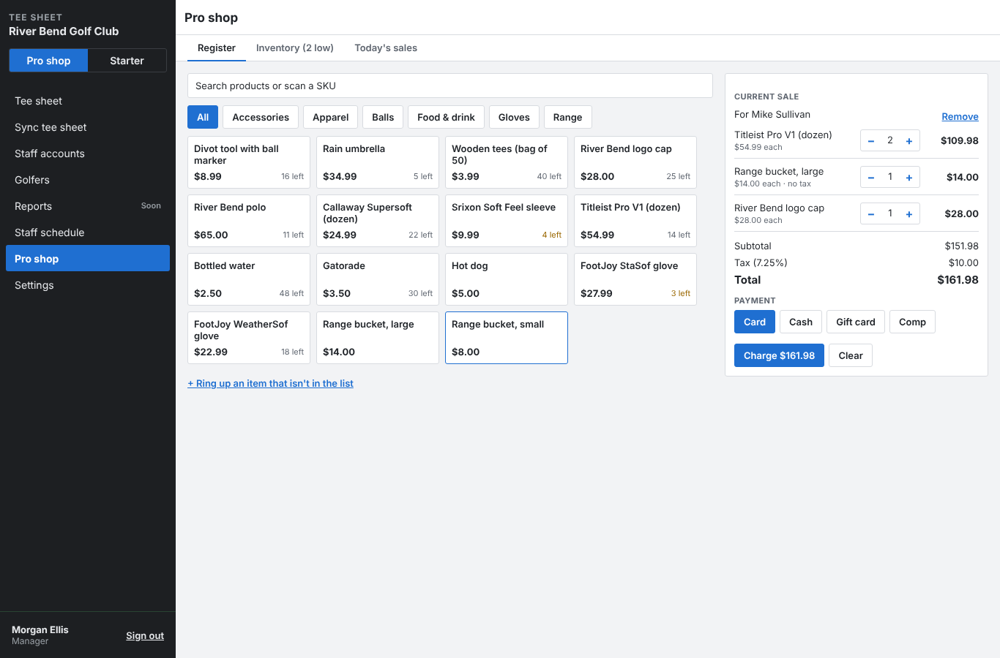

**Reports and closing the day.** **Reports** starts with **Close the day**: it shows what the tee sheet and register took today by payment type, and staff count the cash drawer against it. If the drawer is over or short they must say why. Once a day is closed only a manager can count it again. Managers also see reports for today, yesterday, this or last week, or this or last month: revenue before tax (green fees, carts and extras, pro shop), money taken by payment type (prepaid online is shown apart, since the booking provider collected it), sales tax collected, pro shop sales by category, rounds played, occupancy, no-shows, players by booking source and staff hours, plus a day-by-day table. **Download CSV** saves the day-by-day table for the bookkeeper. Revenue counts on the day of the round; money taken counts on the day it was paid.

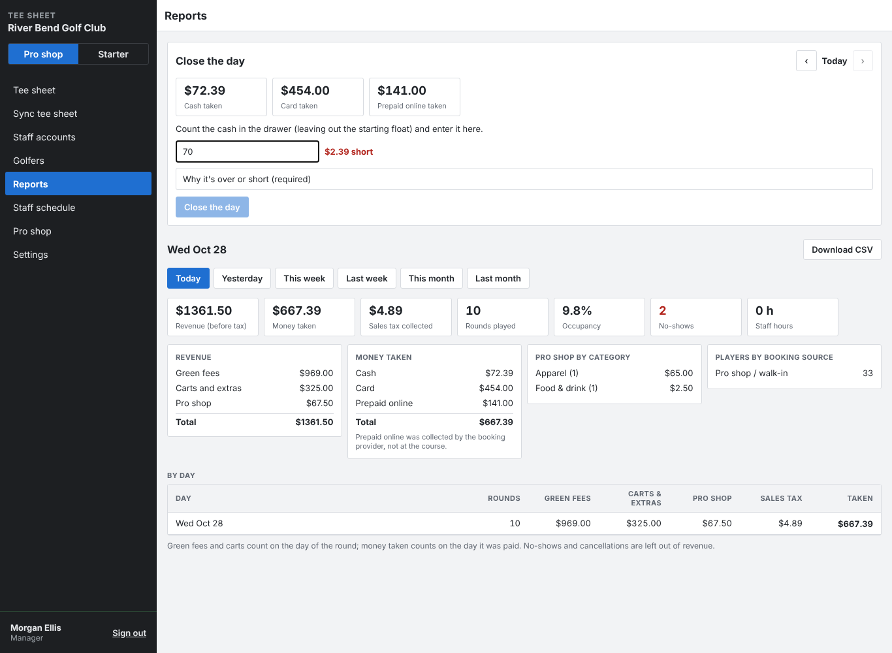

**Checking out.** **Check in** at the pro shop opens a bill for the group: the round's balance, then anything else they're buying. Staff tap quick picks (drinks and snacks first) or search the pro shop items, change quantities, and the total updates with sales tax on the items. The round and items are paid together; if the round goes on a punch card or comp, staff choose how the items are paid. The items are rung up as a pro shop sale on the golfer's account and come off stock, all in the same step as the check-in, so a bad item can't leave a group half checked in. Walk-ins and guests show their price as staff choose players, holes, walking or riding, and resident or nonresident.

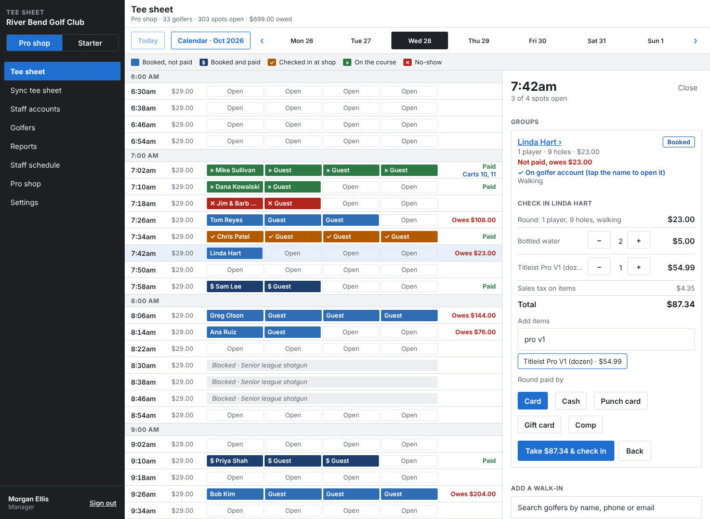

**Calendar.** The 📅 button next to Today opens a month calendar to jump the tee sheet to any date.

**Manager tools.** Signed in as a manager, the app shows a **Waiver** button where the manager can change the wording. Each save is a new version; drivers who already signed stay tied to the version they read.

**Starter station.** The starter doesn't choose resident or nonresident for walk-ins; the pro shop does that when it takes payment.

**Demo build.** `pnpm --filter @golf/staff export:demo` builds a version that runs a pretend River Bend tee sheet in the browser with no server, for showing the app around. Nothing in it is saved.


