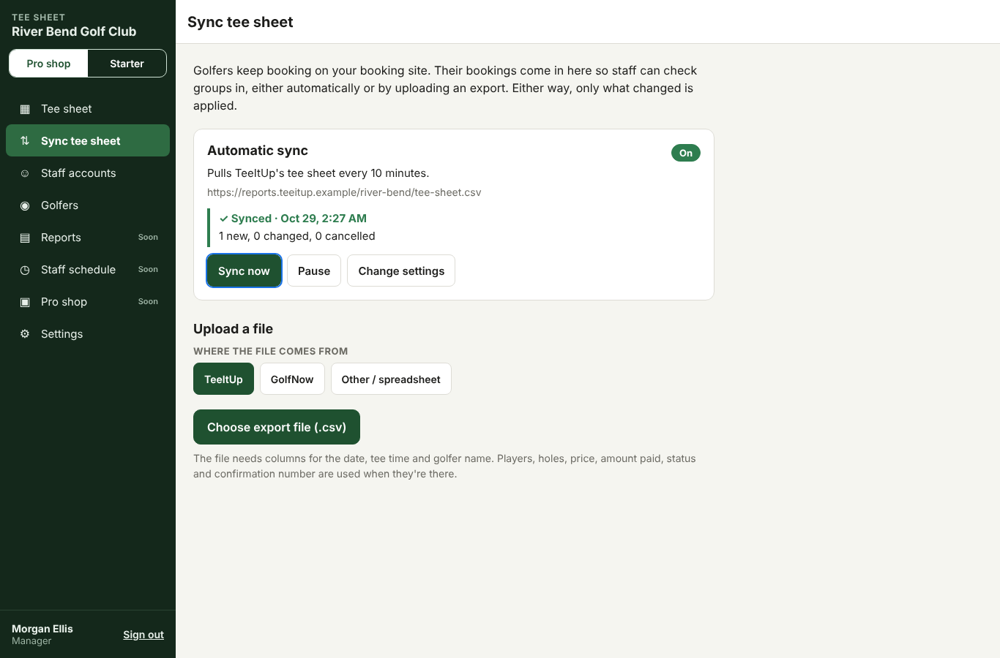
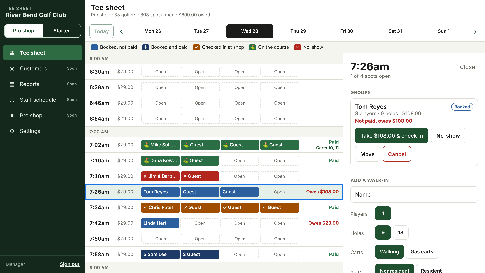
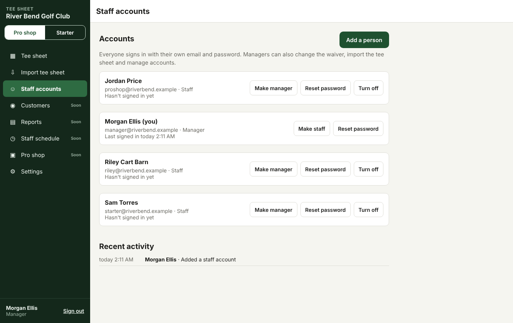
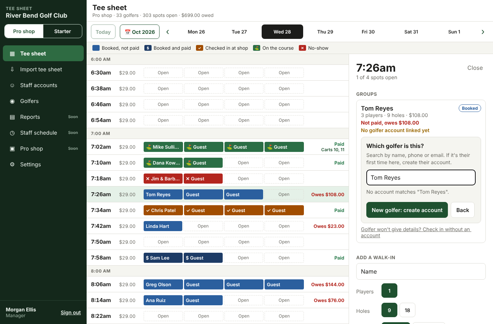
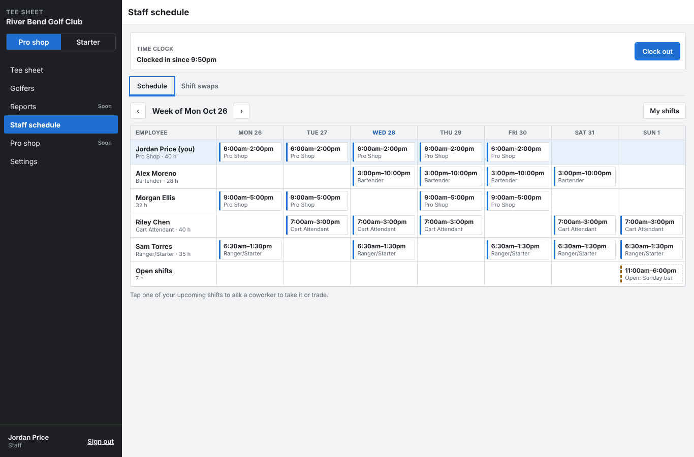
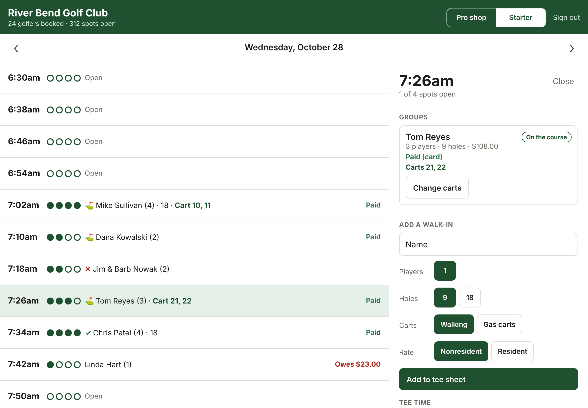

# Golf course management system

Software for running a public golf course: the starter's tee sheet, check-in and carts, and (coming next) POS, inventory, employee scheduling and accounting. Golfers keep booking with the course's existing provider (for River Bend Golf Club, our first course, that's TeeItUp and GolfNow), and those bookings are pulled into our tee sheet. The v1 spec is in the project's planning doc.

## Layout

| Path | What's in it |
| --- | --- |
| `packages/core` | Pure business logic with no database: tee sheet generation and the rate engine, plus River Bend's rates |
| `apps/api` | Staff REST API (Fastify and PostgreSQL), migrations, seed data |
| `apps/staff` | Staff tee sheet app (Expo / React Native): runs on iPad, phones and the web from one codebase |

## Running locally

Needs Node 22, pnpm 10 and PostgreSQL 16.

```sh
pnpm install
cp .env.example .env        # then: export $(cat .env | xargs)
createdb golf && createdb golf_test
pnpm db:seed                # creates the schema and River Bend, and prints its staff key
pnpm dev:api                # http://localhost:3000
pnpm dev:staff              # staff app in the browser; sign in with the staff key
pnpm test
```

## API

Every `/v1` request needs `Authorization: Bearer <key>` with a staff (`sk_`) key for the course. There is no public booking API: golfers book with the course's own booking provider.

| Method and path | What it does |
| --- | --- |
| `GET /v1/courses/:slug` | Course details and add-ons (carts, rentals) |
| `GET /v1/courses/:slug/tee-sheet?date=YYYY-MM-DD` | Every tee time for the day with its groups and cart numbers |
| `PATCH /v1/courses/:slug/tee-times/:id` | Block or reopen a time, or add a note (for example "Ladies league") |
| `POST /v1/courses/:slug/quotes` | Price a group without booking |
| `POST /v1/courses/:slug/bookings` | Add a walk-in or phone booking |
| `GET /v1/courses/:slug/bookings/:id` | One booking with its price lines |
| `POST /v1/courses/:slug/bookings/:id/payments` | Record a payment: `{ "amountCents": 2900, "method": "cash" }` |
| `POST /v1/courses/:slug/bookings/:id/check-in` | Pro shop check-in. The group must be paid; pass `{ "payment": { "method": "card" } }` to take the balance in the same step |
| `POST /v1/courses/:slug/bookings/:id/tee-off` | Starter check-in at the first tee, optionally with `{ "cartNumbers": ["12"] }`. Only after the pro shop has checked the group in |
| `GET /v1/courses/:slug/waiver` | The cart waiver drivers sign |
| `PUT /v1/courses/:slug/waiver` | Manager only. Reword the waiver: `{ "title": "…", "body": "…" }`. Saves a new version |
| `GET /v1/courses/:slug/me` | Whether this key is a `staff` or `manager` key |
| `PUT /v1/courses/:slug/bookings/:id/carts` | Change cart numbers: `{ "cartNumbers": ["12"], "waivers": [{ "cartNumber": "12", "driverName": "…", "signature": "M10 100 L…" }] }` |
| `POST /v1/courses/:slug/bookings/:id/move` | Move the group to another tee time with room |
| `POST /v1/courses/:slug/bookings/:id/no-show` | Mark a no-show |
| `POST /v1/courses/:slug/bookings/:id/cancel` | Cancel and free the spots |

Example booking:

```json
POST /v1/courses/river-bend/bookings
{
  "teeTimeId": "…",
  "holes": 18,
  "customer": { "name": "Pat Golfer", "email": "pat@example.com" },
  "players": [{ "residency": "resident", "ageGroup": "adult" }, { "ageGroup": "senior" }],
  "addOns": [{ "code": "gas_cart", "quantity": 2 }]
}
```

### How it behaves

- **Tee sheet.** Each course has templates (first and last tee, interval, max players by weekday). A day's tee times are created the first time that day is opened, on the course's local clock, including across daylight saving changes.
- **No double-booking.** A booking locks its tee time row for the transaction, so simultaneous requests for the last spots can't overbook.
- **Rates.** The most specific matching rule wins (residency, age group, time window), and ties go to the lower price. Holidays use weekend rates. 18 holes on a 9-hole course is the 9-hole rate plus the replay rate.

## Tee sheet sync and import

Golfers keep booking on the course's booking provider (TeeItUp or GolfNow). Their bookings come in under **Sync tee sheet** in the app, which managers can open.

**Automatic sync.** A manager connects the provider once. The server then pulls the provider's tee sheet on a schedule (every 5 minutes to 1 hour, 10 by default), and also whenever someone presses **Sync now**. Each pull goes through the same import as an uploaded file, so the rules below apply. The screen shows when the last sync ran and what it changed, or why it failed. A failed or empty pull never changes the tee sheet. There are two ways to connect:
- **Report link.** This is a link to a tee sheet CSV export that the provider publishes or schedules. The link must be https. The server refuses links to private network addresses and redirects, gives up after 20 seconds, and caps the file at 6 MB.
- **Provider API.** This needs partner API access that the provider grants to the course. The course or facility ID and API key are stored encrypted (AES-256-GCM, using `SYNC_SECRET`) and are never sent back to the app. Until the provider grants access, a sync shows "waiting for provider access" and doesn't pretend to have synced.

Set `SYNC_SECRET` on the server to a long random string before saving provider API details. The sync loop starts with the API server (`src/server.ts`), and running more than one server is safe because each course's sync is claimed before it runs.



**File import.** A manager can also export the tee sheet as a CSV file and upload it on the same screen. The app first shows what would change, and then applies it.

- **Columns:** headers are matched loosely ("Tee Time", "Time", "Start Time" all work). The file needs a date, a tee time and a golfer name. It also uses players, holes, price, amount paid online, status and confirmation number when they're there.
- **Re-importing** matches bookings on the provider's confirmation number, so nothing is duplicated:
  - New bookings are added.
  - Changed ones are updated (a moved time, more players, a new price).
  - Bookings cancelled on the provider, or missing from a day the file covers, are cancelled here.
  - Groups already checked in or on the course are never touched.
- **Money paid online** is recorded as a prepaid payment, so the pro shop sees "Paid".
- **Pricing:** with no price in the file, our own rates price the booking.
- **Times we don't have:** a tee time the provider has and our sheet doesn't (a shotgun start) is added. Overbooked times are flagged.
- **API:** `POST /v1/courses/:slug/imports` with `{ "source": "teeitup" | "golfnow" | "import", "csv": "…", "dryRun": true }`. Manager keys only. `GET …/imports` lists recent runs.

Live sync: TeeItUp's API is only open to approved partners. Once River Bend (or we) get access, a sync job will feed the same import every few minutes, and the file import stays as a backup.

## AI assistant

Managers can ask Claude, ChatGPT or another MCP client about the course: "how many rounds today?", "who still owes?", "is Mike Sullivan booked this week?", "what did we take last week?". Add a custom connector with the address `https://<your server>/v1/courses/<course>/mcp` and the manager key as a Bearer token.

| Tool | Answers |
| --- | --- |
| `day_summary` | Groups, players, checked in, on course, no-shows, open spots, occupancy, money booked, collected and owed, carts out |
| `list_groups` | The day's groups in tee time order, filtered to unpaid, not checked in, checked in, on course or no-shows |
| `find_golfer` | A golfer's bookings 30 days either side of today |
| `revenue` | Green fees, add-ons and payments by method per day, up to 92 days |

Every tool only reads. Changes still go through the staff app.

## Staff app



The app has a menu on the left (Tee sheet, Golfers, Reports, Staff schedule, Pro shop, Settings). On phones and iPads held upright, the menu folds behind a ☰ button. The tee sheet has one slot per player. Each group is colored by where it is (booked, paid, checked in at the shop, on the course, no-show), and a color key sits above the grid. Each row also shows the time's standard price and what the group owes, with hour dividers and a week strip to move between days.

Accessibility: every row and button has a spoken label for screen readers (for example "7:26am: Tom Reyes, 3 players, booked, not paid, owes $108.00; 1 open"). Keyboard focus is visible. Group colors have at least 4.5:1 contrast with their text, and each state also has its own mark (✓ ⛳ ✕ $), so color is never the only cue. Confirmations happen on the page instead of in pop-up dialogs.

Each device is set to **Pro shop** or **Starter** (switchable in the top bar). Check-in has two steps: the pro shop takes payment and checks the group in, then the starter checks them in at the tee box and assigns carts. The starter can't send off a group the pro shop hasn't checked in.

Each row shows the time, filled spots, the groups (✓ checked in at the shop, ⛳ on the course, ✕ no-show), cart numbers, and whether the time is paid or what's owed. Tapping a time opens a panel to take payment and check in, send a group off with carts, mark no-shows, move a group to another time, cancel, add a walk-in, or block the time with a note. On an iPad in landscape or a desktop the panel sits beside the sheet; on a phone it slides up. The sheet refreshes every 5 seconds, so changes from the pro shop show up on the starter's iPad.

**Cart waivers.** When carts are assigned, the app pops up the course's cart waiver for each cart's driver in turn: they read it, enter their name, tick that they agree, and sign with a finger. A cart can't be assigned until its driver has signed (the API enforces this too, on every route that sets carts). Each signature is stored with the driver's name, the cart, the exact waiver version and the time. The seeded River Bend waiver is sample text: the course must supply its own reviewed wording.

**Staff sign-in.** Each employee and manager signs in with their own email and password. `pnpm db:seed` creates a first manager account (manager@riverbend.example) and prints its one-time password. Managers add everyone else under **Staff accounts**, where they can also make someone a manager, reset a forgotten password and turn off the account of someone who leaves (that signs them out everywhere). Every change on the tee sheet is logged with who made it, shown under **Recent activity**. After 5 wrong passwords an email is locked for 15 minutes. Sessions last 14 days from last use, so a busy iPad stays signed in. A shared device key (sk_) still works for a kiosk nobody signs in to.

**Employee types.** Each person has an employee type, which is the job they do: Pro Shop, Ranger/Starter, Cart Attendant, Bartender, Food & Beverage or Grounds Crew to start with. Managers pick it when adding someone and can change it later. Managers can also add their own types (such as Golf Instructor), rename them or remove them. A removed type stays on the people who have it until they're changed. The type is separate from access: staff or manager access decides what someone may change.



**Golfer accounts.** The first time a golfer is checked in, the pro shop creates their account with their own phone and email (each can only belong to one golfer). After that, **Check in** asks which golfer it is and staff find them by name, phone or email, so every round lands on the same account. If the golfer booked online before with the same email, that record becomes the account and the earlier bookings count too. **Golfers** in the menu shows each account's rounds played, holes, upcoming bookings, no-shows, payments and full history. A golfer who won't give details can still be checked in without an account. On the tee sheet, tapping a linked golfer's name opens their account. On an account, tapping a round opens the tee sheet at that day with the tee time selected.



**Staff schedule.** Everyone sees the week's shifts, one row per person, with open shifts nobody has yet at the bottom. Managers add, change and remove shifts (each can have a job and a note), and **Copy last week** fills a new week from the one before, skipping anything that would clash. A person can't be given two shifts that overlap. Anyone signed in with their own account can **clock in and out**; the punch is tied to the shift they're working. Managers see **Timesheets**: scheduled hours against worked hours for each person, with every punch, and can correct a punch (it's marked as edited).

**Shift swaps.** Tap one of your upcoming shifts to ask a coworker to take it, or to trade it for one of theirs. The coworker accepts or declines. A manager then approves or turns it down, and only then does the schedule change. **Manager must approve swaps** is on by default; a manager can turn it off on the Shift swaps tab, and then the swap happens as soon as the coworker accepts. Changing a shift by hand cancels any swap still open on it.



**Calendar.** The 📅 button next to Today opens a month calendar to jump the tee sheet to any date.

**Manager tools.** Signed in as a manager, the app shows a **Waiver** button where the manager can change the wording. Each save is a new version; drivers who already signed stay tied to the version they read.

**Starter station.** The starter doesn't choose resident or nonresident for walk-ins; the pro shop does that when it takes payment.

**Demo build.** `pnpm --filter @golf/staff export:demo` builds a version that runs a pretend River Bend tee sheet in the browser with no server, for showing the app around. Nothing in it is saved.


